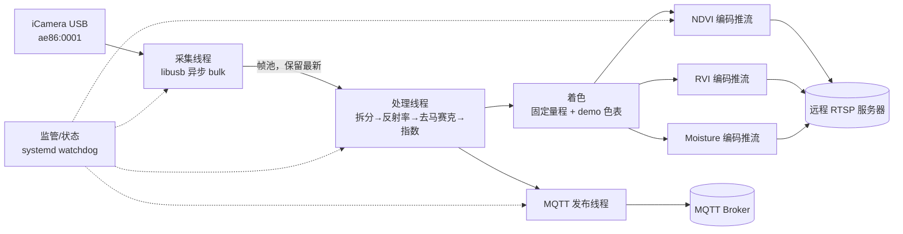

# iCamera 多光谱推流服务设计方案（x86_64 Linux）

整理日期：2026-10-23。依据 [ConsumerMosaicDemo_UseDLL](ConsumerMosaicDemo_UseDLL) 源码、SDK 及标定配置静态分析，并对工作区外 `C:\bob\Documents\agri-dog\ConsumerMosaicDemo`（x86_64 Linux 版 demo）与 `PixelDll.dll` 进行反汇编对照；未连接相机，未运行 demo。

## 1. 需求与结论

| 需求 | 可行性 | 关键结论 |
| --- | --- | --- |
| x86_64 Linux 采集 | 可行 | 移植 libusb 版 [libiCamera.c](ConsumerMosaicDemo_UseDLL/ConsumerMosaicDemo/ConsumerMosaicDemo/iCamera-sdk/src/libiCamera.c)，需修复释放与重连 |
| 开机自启、异常恢复 | 可行 | systemd + udev + 进程内 USB 重连 |
| 按 demo 算法反演着色 | 可行，原生实现 | 已由反汇编还原完整算法，见第 2.5 节；不再需要 Wine 或 `PixelDll.dll` |
| NDVI、RVI、Moisture 三路流 | 可行 | A=NDVI、B=SAVI、C=NDVI705、D=Moisture；RVI = R776/R682，与 demo NDVI 同波段 |
| 推送远程 RTSP | 可行 | 每路独立 H.264 编码，RTSP over TCP 推送 |
| 波段数据发送 MQTT | 可行，需分级 | 完整 9 波段浮点数据约 12.1 MiB/帧，不适合直接走 MQTT |

**推荐路线：** 生产服务用 C++17 实现单进程多线程；算法还原与对齐验证用 Python + NumPy。算法按第 2.5 节规格原生实现，并以 Windows `PixelDll.dll` 为参照做逐像素对齐验证。

## 2. Demo 与 SDK 分析

### 2.1 交付物与平台

| 文件 | 平台/形态 | 用途 |
| --- | --- | --- |
| [PixelDll.h](ConsumerMosaicDemo_UseDLL/PixelDll.h) + `PixelDll.dll` | Windows PE32+，x64 | 拆分马赛克、去马赛克、指数计算 |
| `iCameraSDK_DLL.dll` | Windows PE32，x86 | CyUSB 采集，C++ 名称修饰导出 |
| [iCameraSDK.cpp](ConsumerMosaicDemo_UseDLL/ConsumerMosaicDemo/ConsumerMosaicDemo/iCameraSDK.cpp) | Windows 源码 | CyUSB 采集实现，demo 实际编译使用 |
| [libiCamera.c](ConsumerMosaicDemo_UseDLL/ConsumerMosaicDemo/ConsumerMosaicDemo/iCamera-sdk/src/libiCamera.c) | 可移植 C 源码 | libusb 采集，Linux 方案的基础 |
| [Config.ini](ConsumerMosaicDemo_UseDLL/ConsumerMosaicDemo/ConsumerMosaicDemo/Calibration/Config.ini) | 标定配置 | 9 波段波长、波段排列及曝光参数 |

`PixelDll.dll` 导出 `CalIndex`、`DeMosiac`、`dividePic`、`mergeImages`、`splitImage`，依赖 `KERNEL32`、`VCRUNTIME140` 和 UCRT，**不能在 Linux 原生链接**。

“适配 x86 的 demo”是 Windows Visual Studio/Qt 工程，并非 Linux 程序；CyUSB 部分不能移植到 Linux。

工作区外的 `C:\bob\Documents\agri-dog\ConsumerMosaicDemo` 是同一 demo 的 **x86_64 Linux 编译版**（无源码、未剥离符号），自带 x86_64 版 `libiCamera.so`、Qt5 和 FFmpeg 依赖。其中 `DeMosiac` 为独立函数，`CalIndex` 内联在 `CameraThread::Slot_ContinueGrab` 中；内置的 RTSP 推流对界面窗口截图后编码，不适合作为无界面服务。它可用于在目标机验证 x86_64 采集链路。

### 2.2 传感器与波段

| 参数 | 值 |
| --- | --- |
| VID:PID | `ae86:0001` |
| 原始帧 | 752×480，8 bit RAW，每帧 360,960 字节 |
| 有效区域 | 744×474 |
| 波段 | 3×3 马赛克共 9 波段，每波段 248×158 |
| 波长（nm） | 624、644、664、682、704、724、740、760、776 |
| 波段排列 | `BandIndex0..8 = 8,6,7,5,3,4,2,0,1` |
| 默认曝光参数 | `ExposureTime=500`、`Gain=0`、`AEC=0`、`Clock=0` |

光谱范围是 624～776 nm，覆盖红光、红边至近红外起始段，**没有 970/1450 nm 等常规水分吸收波段**。反汇编确认 demo 的 Moisture 实际就是 **776 nm 反射率本身**，并非水分指数公式；其业务含义以厂商说明为准。

### 2.3 Demo 处理流程

[CameraThread.cpp](ConsumerMosaicDemo_UseDLL/ConsumerMosaicDemo/ConsumerMosaicDemo/CameraThread.cpp) 的实时指数流程：

```text
iCameraGrabFrame()，最多重试 10 次
→ TripleBufferFlip(true)
→ splitImage(RAW, 9 个 248×158 波段, BandIndex)
→ 反射率 = (raw - dark) / (white - dark)，NaN/Inf 置 0
→ DeMosiac：9 × 248×158 → 9 × 744×474 float
→ CalIndex(反射率, mask, 指数, filter_th=0.25, &iii)
→ 对每个指数，在 mask[0]==1 的像素内求 min/max
→ 线性拉伸到 0～255
→ 反射率波段[6] < 0.25 的像素置黑
→ 颜色表 colortable_{r,g,b}[255 - v]
→ 2×2 拼图：4 个 744×474 指数图，间隔 30 px
```

- 暗场、白板分别保存为 `./result/dark.raw` 和 `./result/white.raw`，格式为 9×248×158、uint8、BSQ。未采集时，默认使用暗场 0、白板 255。
- `idx_num=4`，界面标签为 A/B/C/D：**A=NDVI、B=SAVI、C=NDVI705、D=Moisture**，即 `pic_bandDivied_i[0..3]`；公式见第 2.5 节。
- 颜色映射是逐帧 min-max 拉伸，同一颜色在不同帧代表的数值不同，不适合监测类视频流。
- 存在缺陷：`max == min` 时除零；无有效 mask 时 `iii` 可能未定义；停止时只靠标志位退出循环。

### 2.4 libusb SDK 用作服务前须修复的问题

| 问题 | 影响 | 处理方案 |
| --- | --- | --- |
| `libusb_init` 失败、参数错误时直接 `exit` | 服务被 SDK 直接终止 | 改为返回错误码 |
| `FreeiCamera` 只取消 1 个传输（循环被注释） | 其余 7 个传输泄漏，重连后行为不确定 | 取消全部传输并等待回调结束 |
| 不释放接口、不调用 `libusb_exit` | 重连泄漏、设备可能保持被占用 | 完整执行 release、close、exit |
| 每次初始化都 `malloc` 缓冲区，从不释放 | 每次重连都会泄漏内存 | 由服务管理缓冲区池 |
| `g_DevIndex != 0` 时不会打开设备 | 多设备选择无效 | 按序列号或总线地址打开 |
| `libusb_handle_events` 无超时 | 拔线时可能阻塞，无法优雅停止 | 使用 `libusb_handle_events_timeout_completed` |
| 全局状态，单一实例 | 无法安全支持多台相机 | 封装为类，仅一个实例占用一台设备 |
| 未设置曝光/增益 | 与 demo 实际参数不一致 | 按 Windows demo 发送 `0x22` 系列控制命令，并在 Linux 实测验证 |

Windows demo 使用的参数命令：AEC `0x22/0xaf`，曝光 `0x22/0x0b`，增益 `0x22/0x35`，时钟 `0x22/0x0d`。**Linux libusb 固件路径是否接受相同命令，需在实际设备上验证。**

### 2.5 反演着色算法规格（反汇编还原）

对 Linux 版 demo 主程序与 `PixelDll.dll` 的 `DeMosiac`、`CalIndex`、`splitImage` 分别反汇编对照：两者常量（0.67/0.33/0.5、1.5/0.5、−1/2、0.25）、波段下标和循环结构一致。色表由 Linux 版构造函数还原，与 Windows 源码 [CameraThread.h](ConsumerMosaicDemo_UseDLL/ConsumerMosaicDemo/ConsumerMosaicDemo/CameraThread.h) 中的 `colortable_r/g/b` 逐字节一致。以下步骤 1、2、5、6、7 在 Windows 源码中也可直接对照。

波段下标 k 与波长（ENVI 头按 `Band0..8` 顺序写出）：

| k | 0 | 1 | 2 | 3 | 4 | 5 | 6 | 7 | 8 |
| --- | --- | --- | --- | --- | --- | --- | --- | --- | --- |
| 波长 nm | 624 | 644 | 664 | 682 | 704 | 724 | 740 | 760 | 776 |

1. **拆分**：对有效区 `row∈[0,474)`、`col∈[0,744)`，`k = BandIndex[(row%3)*3 + col%3]`，`S_k[(row/3)*248 + col/3] = raw[(row+CutTop)*752 + col]`。
2. **反射率**：`R_k = (S_k − D_k) / (W_k − D_k)`（float），NaN、±Inf 置 0，不截断。
3. **去马赛克**（每个波段独立，`r = k/3`、`c = k%3`，输出 `U` 为 744×474）：
   - 放置：`U[3y+r][3x+c] = R_k[y][x]`，`y∈[0,158)`、`x∈[0,248)`。
   - 插值：对 `y∈[0,157)`、`x∈[0,247)`，记锚点 `a=U[3y+r][3x+c]`、右块 `b=U[3y+r][3x+3+c]`、下块 `d=U[3y+3+r][3x+c]`、右下块 `e=U[3y+3+r][3x+3+c]`，相对锚点写入：

     | 位置 (行, 列) | 取值 |
     | --- | --- |
     | (0, +1) / (0, +2) | 0.67a+0.33b / 0.33a+0.67b |
     | (+1, 0) / (+2, 0) | 0.67a+0.33d / 0.33a+0.67d |
     | (+1, +1) / (+2, +2) | 0.67a+0.33e / 0.33a+0.67e |
     | (+1, +2) | 0.5·(0,+2) + 0.5·(+2,+2) |
     | (+2, +1) | 0.5·(+2,0) + 0.5·(+2,+2) |

   - 乘加在 double 中计算，每个结果先舍入为 float 再参与后续计算。
   - **锚点偏移按波段下标 k 取值，而非该波段在马赛克中的物理位置**，波段间存在最多 2 像素的配准偏差；为与 demo 一致保留此行为。
   - 每个波段的前 r 行、前 c 列及末尾约 3 行/列不会被写入：demo 复用同一临时缓冲，这些像素残留上一波段或未初始化内存。服务实现改为复制最近的有效行/列，对齐验收时排除四周 3 像素。
4. **指数与 mask**（逐像素，`U_k` 为去马赛克后的反射率）：

   | 输出 | 公式 | 波长 |
   | --- | --- | --- |
   | mask | `U_6 ≥ 0.25` | 740 nm |
   | A NDVI | `(U_8 − U_3) / (U_8 + U_3)` | 776 / 682 nm |
   | B SAVI | `1.5·(U_8 − U_3) / (U_8 + U_3 + 0.5)`（double） | 776 / 682 nm，L=0.5 |
   | C NDVI705 | `(U_7 − U_4) / (U_7 + U_4)` | 760 / 704 nm |
   | D Moisture | `U_8` | 776 nm 反射率 |

   A、B、C 截断到 `[−1, 2]`，D 不截断。`iii` 为最后一个 mask=1 的像素下标。
5. **归一化**：每个指数以 `i[iii]` 为初值，在 mask=1 的像素内求 min/max；`v = (uint8)(int)((i − min) / (max − min) × 255)`（向零截断）。
6. **着色**：`U_6 < 0.25` 的像素置黑；否则 RGB = `(colortable_r, colortable_g, colortable_b)[255 − v]`。线程按 B、G、R 顺序发送、界面按 BGR 写缓冲，两次互换后最终颜色即为上式。
7. **拼图**：白底 1578×1038 画布，边距 30 像素，按 A、B / C、D 排成 2×2。服务中各指数单独推流，不再拼图。

已知缺陷及服务中的处理：`max == min` 时除零（置黑并计数）；无有效像素时 `iii` 为 0（整幅置黑）；分母为 0 产生的 NaN 按无效像素处理。

## 3. 第一阶段：算法实现与对齐验证

按第 2.5 节规格用 C++ 原生实现，不依赖 Wine 或 `PixelDll.dll`。反汇编还原的结果必须经以下对齐验证后才能上线：

1. **DLL 对照测试（无需相机）**：在 Windows 上写一个小程序调用 `PixelDll.dll` 的 `splitImage`、`DeMosiac`、`CalIndex`，输入坐标编码图、常数图、渐变图和随机反射率，保存输出作为参照数据；服务实现以相同输入计算并比对。
2. **真实数据对照**：用 demo 的“保存原始图”与“保存指数”功能在相机静止、场景不变时采集数据，作为端到端参照。
3. **验收标准**：拆分逐字节一致；反射率、去马赛克和指数除四周 3 像素外最大绝对误差 ≤ 1e-6；动态量程着色逐像素误差 ≤ 1。

使用反汇编结果重新实现厂商算法前，需确认与厂商的许可条款允许。

### 3.1 指数映射与 RVI

| `CalIndex` 输出 | 指数 | 服务中的用途 |
| --- | --- | --- |
| `i[0]`（A） | NDVI | RTSP 流 1、MQTT 统计 |
| `i[1]`（B） | SAVI | MQTT 统计；可选第 4 路流 |
| `i[2]`（C） | NDVI705（红边 NDVI） | MQTT 统计；可选第 5 路流 |
| `i[3]`（D） | Moisture | RTSP 流 3、MQTT 统计 |
| 由 776/682 nm 计算 | RVI | RTSP 流 2、MQTT 统计 |

反汇编确认 demo 的 NDVI 是未缩放的标准公式（NIR=776 nm，Red=682 nm），因此 RVI 直接用同一对波段计算，与 demo NDVI 完全自洽：

$$\mathrm{RVI} = \frac{U_8}{U_3} = \frac{1 + \mathrm{NDVI}}{1 - \mathrm{NDVI}}$$

- `U_3` 小于 1e-6、NaN 或 mask=0 的像素：RVI 记为无效（置黑）。
- RVI 的固定量程上限截断（默认 8），超出部分取最大颜色。
- RVI 不在 demo 中，其动态量程着色按第 2.5 节步骤 5、6 同样处理。

## 4. 总体架构

### 4.1 进程与线程



- 采集与处理之间使用**容量为 2 的帧池，丢弃旧帧**，避免 USB 回调被阻塞。
- 每路编码器各有容量为 2、保留最新帧的队列；一路 RTSP 断开不能影响其余两路或 MQTT。
- MQTT 发布异步执行，Broker 不可用时只缓存有限条数，超出后丢弃并计数。

### 4.2 语言选择

| 维度 | C++17（推荐生产） | Python 3.10+（推荐算法验证） |
| --- | --- | --- |
| 采集 | 直接复用并修复 C SDK | `python-libusb1` 或 ctypes 调用修复后的 `.so` |
| 算法 | 手写循环 + OpenMP/SIMD，延迟可预测 | NumPy 向量化，便于黄金数据比对 |
| 推流 | FFmpeg libav* 或 ffmpeg 子进程 | ffmpeg 子进程 |
| MQTT | Eclipse Paho C/C++ 或 libmosquitto | paho-mqtt |
| 部署 | 单一二进制 + 动态库 | 需要虚拟环境及依赖锁定 |
| 风险 | 开发量较大 | GIL 与 GC 带来延迟抖动；长时间运行的内存需重点观察 |

按单帧计算量估算，NumPy 实现 10～15 fps 可行，但这只是估计，需在目标 CPU 上实测。若需同时满足低延迟和长期稳定运行，选择 C++。

## 5. 模块设计

### 5.1 目录结构（C++）

```text
icamera-ms/
  CMakeLists.txt
  third_party/icamera/          # 修复后的 libiCamera，改为可重入接口
  src/
    main.cpp                    # 配置、信号、sd_notify、线程编排
    camera/UsbCamera.{h,cpp}    # 打开、参数设置、取帧、重连
    algo/Mosaic.{h,cpp}         # splitImage/dividePic 等价实现
    algo/Reflectance.{h,cpp}    # 暗场/白板标定
    algo/Demosaic.{h,cpp}       # DeMosiac 等价实现（第 2.5 节）
    algo/Indices.{h,cpp}        # NDVI/RVI/Moisture + mask
    algo/Colorize.{h,cpp}       # demo 色表、固定/动态量程
    algo/Spectrum.{h,cpp}       # ROI 光谱曲线统计
    stream/RtspPublisher.{h,cpp}
    mqtt/MqttPublisher.{h,cpp}
    util/FramePool.h, Config.{h,cpp}, Metrics.h
  tools/
    calib_capture.cpp           # 暗场/白板采集工具
    pixeldll_harness.cpp        # Windows 上调用 PixelDll 生成参照数据
    golden_compare.py           # 服务实现与参照数据比对
  deploy/
    icamera-ms.service, 99-icamera.rules, config.yaml.example
```

### 5.2 核心接口

```cpp
struct RawFrame {
    std::vector<uint8_t> data;          // 752*480
    uint64_t seq;
    std::chrono::system_clock::time_point ts;
};

struct SpectralCube {                   // 9 x 744x474, BSQ, 反射率
    std::array<std::vector<float>, 9> band;
    std::vector<uint8_t> mask;          // 1=有效像素
};

class IAlgorithm {                      // 厂商库与自研实现共用同一接口
public:
    virtual ~IAlgorithm() = default;
    virtual void split(const RawFrame&, std::array<std::vector<uint8_t>, 9>&) = 0;
    virtual void demosaic(const std::array<std::vector<float>, 9>&, SpectralCube&) = 0;
    virtual void indices(const SpectralCube&, std::map<std::string, std::vector<float>>&) = 0;
};
```

`IAlgorithm` 隔离算法实现，便于用参照数据单独测试；将来若取得厂商 Linux 库，也只需替换实现。

### 5.3 采集模块

1. 按配置的 VID/PID 和可选序列号打开设备；若内核驱动已绑定则先分离，再声明接口 0。
2. 发送初始化寄存器，并下发 AEC、曝光、增益、时钟；每条命令都检查返回值。
3. 提交 8 个异步 bulk 传输，循环调用 `libusb_handle_events_timeout_completed`（100 ms）。
4. 帧长等于 360,960 字节时视为完整帧；长度异常则丢弃并累加错误计数。
5. 若连续 3 秒无完整帧，或传输状态为 `NO_DEVICE`/`ERROR`，则执行完整释放，按 1、2、4…最长 30 秒退避后重连。
6. 停止时：设置退出标志，取消全部传输，等待所有回调完成，再依次释放接口、关闭设备、退出 libusb。

### 5.4 算法模块

- **拆分**：裁剪至 744×474（受 `CutTop`、`CutLeft` 影响），再按 `BandIndex` 拆成 9 个 248×158 波段。
- **反射率**：按第 2.5 节步骤 2 计算，与 demo 一致不截断。标定文件读取时校验尺寸、曝光、增益是否与当前参数一致；不一致时将状态置为 `calibration_mismatch`。
- **去马赛克**：按第 2.5 节步骤 3 实现，边缘未写入像素改为复制最近有效行/列。
- **mask**：740 nm 反射率（`U_6`）≥ 0.25 为有效像素，阈值可配置。
- **指数**：NDVI、SAVI、NDVI705、Moisture 按第 2.5 节步骤 4 计算；RVI 按第 3.1 节计算。NaN/Inf 及分母绝对值小于 1e-6 的像素记为无效。

### 5.5 着色

使用 demo 的 `colortable_r/g/b`，保留 `255 - v` 的映射方向；无效像素置黑，与 demo 一致。

| 模式 | 说明 | 用途 |
| --- | --- | --- |
| `fixed`（默认） | 例如 NDVI [-0.2, 1.0]、RVI [0, 8]，量程可配置 | 跨帧、跨设备可比较 |
| `dynamic` | 与 demo 相同的逐帧 min-max 拉伸 | 与 demo 画面对照验收 |

动态模式需处理 `max == min`。可选在画面角落叠加指数名、量程和时间戳；叠加内容只来自配置和内部数值，不拼接外部输入。

### 5.6 RTSP 推流

三路使用相同分辨率 744×474（宽高均为偶数，满足 yuv420p 要求）。初版建议用 ffmpeg 子进程，通过 stdin 写入原始 BGR 帧：

```bash
ffmpeg -hide_banner -loglevel warning \
  -f rawvideo -pix_fmt bgr24 -s 744x474 -r 10 -i - \
  -c:v libx264 -preset ultrafast -tune zerolatency \
  -g 20 -bf 0 -pix_fmt yuv420p \
  -f rtsp -rtsp_transport tcp "$RTSP_URL_NDVI"
```

- 每路一个子进程。写入失败或进程退出时，只重启该路，按 1～30 秒指数退避。
- 帧率以处理线程的实际输出为准，可配置为 5/10/15 fps；以墙钟时间驱动输出，避免因丢帧导致时间戳漂移。
- 第二阶段可改为 libav* 进程内编码，减少一次内存复制；有 Intel 核显时可评估 VAAPI 硬件编码。
- RTSP 地址可能包含凭据，**只从环境变量或密钥文件读取，不写入日志**，日志中只记录主机和路径。

路径示例：`/live/icamera_ndvi`、`/live/icamera_rvi`、`/live/icamera_moisture`。最终地址和鉴权方式由视频服务器侧分配。

### 5.7 MQTT 波段数据

数据量估算：每帧 9 波段 × 744×474 × 4 字节 ≈ 12.1 MiB；10 fps 时约 121 MiB/s。**完整立方体不能直接作为 MQTT 实时消息发送。** 因此按以下层级设计：

| 层级 | 主题 | 内容 | 默认频率 | QoS |
| --- | --- | --- | --- | --- |
| 状态 | `agri/{device_id}/icamera/status` | 在线、帧率、错误、标定状态；设置 retain 和 LWT | 5 s 及状态变化时 | 1 |
| 波段统计 | `agri/{device_id}/icamera/bands/stats` | 9 波段在有效 mask 内的 mean/std/min/max/p5/p50/p95 | 1 Hz | 0 |
| 指数统计 | `agri/{device_id}/icamera/index/stats` | NDVI/RVI/Moisture 统计值、有效像素占比 | 1 Hz | 0 |
| 光谱曲线 | `agri/{device_id}/icamera/spectrum` | 各 ROI 的 9 波段灰度与反射率，见第 5.8 节 | 1 Hz | 0 |
| 降采样网格 | `agri/{device_id}/icamera/bands/grid` | 9 × 62×40 网格（12×12 区域均值），uint16 定点二进制 | 0.2～1 Hz，可关闭 | 0 |
| 全量快照 | `agri/{device_id}/icamera/bands/snapshot` | 只发送对象存储地址、SHA-256 和元数据，不发送数据本体 | 按需 | 1 |

统计消息示例：

```json
{
  "schema": "icamera.bands.stats/v1",
  "device_id": "dog01-icam0",
  "seq": 102345,
  "ts": "2026-10-23T08:00:00.120Z",
  "exposure": 500, "gain": 0,
  "calibration_id": "20261023-0730",
  "valid_ratio": 0.62,
  "bands": [
    {"wl": 624, "mean": 0.081, "std": 0.012, "min": 0.01, "max": 0.33, "p50": 0.078}
  ]
}
```

降采样网格的二进制格式：固定头部（magic、版本、宽、高、波段数、缩放系数、seq、时间戳）+ BSQ uint16 小端数据（反射率 ×10000）。9 × 62×40 × 2 字节约 44.6 KB，需确认 Broker 的单条消息上限。

安全要求：Broker 使用 TLS（8883）、每台设备独立账号；凭据通过 `EnvironmentFile` 提供；ACL 限制设备只能发布自己的主题。若开放 `.../cmd` 控制主题（如触发暗场/白板采集），必须校验 JSON schema 和命令白名单，并记录审计日志。

### 5.8 光谱曲线（灰度值曲线）

demo 的灰度值曲线**不做成视频流**，而是通过 MQTT 发送数值，由客户端绘图。

| 对比项 | 视频流（服务端画图再编码） | MQTT 数据 + 客户端绘图 |
| --- | --- | --- |
| 数据量 | 持续占用数百 kbps | 每条约 0.5–2 KB，1 Hz |
| 清晰度 | H.264 压缩后细线和文字发糊 | 矢量绘制，始终清晰 |
| 交互 | 不能缩放、查看数值、切换取样点 | 均可实现 |
| 存储分析 | 只能存视频，取不回数值 | 可直接入库、做趋势分析 |
| 服务端负担 | 多一路绘图和编码 | 几乎为零 |

**取样区域（ROI）：** demo 是用鼠标点选取样点，服务无鼠标，改为配置或远程设置。

- `valid_mean`（始终开启）：整幅画面中有效 mask 像素（植被区域）的平均光谱。
- 自定义 ROI：最多 8 个矩形，坐标以 744×474 的去马赛克画面为准；单点取样即 1×1 矩形。建议使用不小于 8×8 的区域取平均，以降低噪声。
- 灰度取自拆分后的 9 个 248×158 波段，坐标按 1/3 换算，与 demo 曲线的取值方式一致；反射率取自去马赛克后的立方体。
- 自定义 ROI 只统计其中的有效像素，并输出 `valid_ratio`；有效像素为 0 时，该 ROI 的反射率发 `null`。

**数值内容：** demo 画的是原始灰度（0–255），受曝光影响大。服务同时发送：

- `grey`：原始灰度均值，用于诊断曝光是否合适（如接近 255 即饱和）。
- `reflectance`：标定后的反射率均值，用于业务分析。未标定时不发送该字段，并设置 `calibrated=false`。
- `saturated`：各波段灰度 ≥ 250 的像素占比，提示需要降低曝光。

消息示例：

```json
{
  "schema": "icamera.spectrum/v1",
  "device_id": "dog01-icam0",
  "seq": 102345,
  "ts": "2026-10-23T08:00:00.120Z",
  "wavelengths": [624, 644, 664, 682, 704, 724, 740, 760, 776],
  "exposure": 500, "gain": 0,
  "calibrated": true,
  "calibration_id": "20261023-0730",
  "rois": [
    {"id": "valid_mean", "rect": null, "valid_ratio": 0.62,
     "grey": [41, 45, 38, 52, 88, 120, 131, 135, 137],
     "reflectance": [0.051, 0.058, 0.044, 0.070, 0.152, 0.281, 0.322, 0.335, 0.341],
     "saturated": [0, 0, 0, 0, 0, 0, 0.001, 0.002, 0.002]},
    {"id": "center", "rect": [356, 221, 32, 32], "valid_ratio": 1.0,
     "grey": [40, 44, 37, 50, 90, 124, 135, 139, 140],
     "reflectance": [0.049, 0.056, 0.042, 0.067, 0.156, 0.290, 0.333, 0.346, 0.350],
     "saturated": [0, 0, 0, 0, 0, 0, 0, 0, 0]}
  ]
}
```

`rect` 格式为 `[x, y, w, h]`。`wavelengths` 与数组顺序一一对应，客户端不应假定固定波长。

**远程设置 ROI（可选）：** 订阅 `agri/{device_id}/icamera/cmd`，只接受白名单命令：

```json
{"cmd": "set_rois", "req_id": "a1b2", "rois": [{"id": "center", "rect": [356, 221, 32, 32]}]}
```

- 校验：`id` 仅允许 `[A-Za-z0-9_-]{1,32}`；最多 8 个；矩形必须完全落在 744×474 内且宽高 ≥ 1；消息体不超过 4 KB。任一项不合格则整条拒绝。
- 执行结果发布到 `agri/{device_id}/icamera/cmd/ack`（含 `req_id`、成功与否、拒绝原因），并写审计日志。
- 生效的 ROI 持久化到 `/var/lib/icamera-ms/rois.json`，重启后保留。

**客户端呈现：**

- 用 ECharts 等图表库绘制折线：横轴为波长（nm），纵轴可切换灰度（0–255）或反射率；每个 ROI 一条曲线。
- 与视频画面放在同一页面；在视频上叠加 ROI 框，便于对照。
- 按时间戳与视频对齐。需要精确对应到某一帧时，在视频角落叠加帧序号，与消息中的 `seq` 对照。
- 入库时保留 `calibration_id` 和 `exposure`，不同标定或曝光下的灰度不能直接比较。

**例外：** 只有当观看端只能播放 RTSP、且无法开发任何客户端时，才在 NDVI 画面角落叠加一个小曲线图（配置 `overlay_spectrum: true`，默认关闭），仅作示意，数值以 MQTT 为准。不单独开一路曲线视频。

## 6. 标定流程

1. 停止推流或进入标定模式，固定曝光和增益（关闭 AEC）。
2. 遮光采集 N=32 帧，取平均作为暗场；放置白板采集 32 帧，取平均作为白板。
3. 保存到 `/var/lib/icamera-ms/calib/{id}/`，包含 `dark.raw`、`white.raw`、ENVI `.hdr` 和 `meta.json`（曝光、增益、时钟、温度、时间、操作人）。
4. 通过符号链接 `current` 原子切换生效标定；切换失败时保留上一版。
5. 白板上若有饱和像素（≥ 250）占比超过阈值，则拒绝该标定。
6. 无有效标定时，服务仍推送原始灰度预览，指数流显示“未标定”，状态消息中 `calibrated=false`；不能以 0/255 默认值冒充反射率。

## 7. 部署与自启动

### 7.1 依赖（Ubuntu 22.04 示例）

```bash
sudo apt install build-essential cmake pkg-config libusb-1.0-0-dev \
  ffmpeg libpaho-mqtt-dev libpaho-mqttpp-dev libyaml-cpp-dev libsystemd-dev
```

`libpaho-mqttpp-dev` 在部分发行版中不存在，可改用 libmosquitto，或从源码构建 Paho C++。

### 7.2 udev 规则：`/etc/udev/rules.d/99-icamera.rules`

```text
SUBSYSTEM=="usb", ATTR{idVendor}=="ae86", ATTR{idProduct}=="0001", MODE="0660", GROUP="icamera", TAG+="systemd"
```

只授权给专用用户组，**不使用 `MODE="0666"`**。

### 7.3 systemd：`/etc/systemd/system/icamera-ms.service`

```ini
[Unit]
Description=iCamera multispectral stream service
Wants=network-online.target
After=network-online.target

[Service]
Type=notify
User=icamera
Group=icamera
EnvironmentFile=/etc/icamera-ms/secrets.env
ExecStart=/opt/icamera-ms/bin/icamera-ms --config /etc/icamera-ms/config.yaml
Restart=always
RestartSec=5
WatchdogSec=30
StateDirectory=icamera-ms
NoNewPrivileges=true
ProtectSystem=strict
ProtectHome=true
PrivateTmp=true

[Install]
WantedBy=multi-user.target
```

```bash
sudo systemctl daemon-reload
sudo systemctl enable --now icamera-ms.service
journalctl -u icamera-ms.service -f
```

- 处理线程只有在持续产出帧时才发送 `WATCHDOG=1`，因此服务假死时会被 systemd 重启。
- `secrets.env` 权限为 `0600`，仅包含 RTSP/MQTT 凭据。
- 服务独占相机。同一台机器上不能同时运行 demo、旧的 `icamera.service` 或其他采集程序。

### 7.4 配置示例：`config.yaml`

```yaml
device: {vid: 0xae86, pid: 0x0001, serial: "", aec: 0, exposure: 500, gain: 0, clock: 0}
geometry: {cut_top: 0, cut_left: 0, band_index: [8,6,7,5,3,4,2,0,1],
           wavelengths: [624,644,664,682,704,724,740,760,776]}
calibration: {dir: /var/lib/icamera-ms/calib/current}
algorithm: {mask_band: 6, mask_threshold: 0.25, edge_fill: replicate}
indices:
  ndvi:     {formula: nd,    bands: [8, 3], range: [-0.2, 1.0], color_mode: fixed, stream: true}
  rvi:      {formula: ratio, bands: [8, 3], range: [0.0, 8.0],  color_mode: fixed, stream: true}
  moisture: {formula: band,  bands: [8],    range: [0.0, 1.0],  color_mode: fixed, stream: true}
  savi:     {formula: savi,  bands: [8, 3], range: [-0.2, 1.0], color_mode: fixed, stream: false}
  ndvi705:  {formula: nd,    bands: [7, 4], range: [-0.2, 1.0], color_mode: fixed, stream: false}
stream: {fps: 10, gop: 20, urls_env: [RTSP_URL_NDVI, RTSP_URL_RVI, RTSP_URL_MOISTURE]}
mqtt: {host_env: MQTT_HOST, port: 8883, tls: true, device_id: dog01-icam0,
       stats_hz: 1, grid_hz: 0.2, grid_block: 12,
       spectrum: {hz: 1, max_rois: 8, accept_cmd: false, overlay_spectrum: false,
                  rois: [{id: center, rect: [356, 221, 32, 32]}]}}
```

Moisture、SAVI、NDVI705 的固定量程是初始值，需根据现场实测数据的分布调整。`bands` 为第 2.5 节的波段下标，默认值与 demo 一致。

## 8. Python 实现要点

若选择 Python 实现：

- 采集：使用 `usb1`（python-libusb1）异步传输实现第 5.3 节逻辑；或将修复后的 libiCamera 编译成 `.so` 后用 ctypes 调用。
- 结构：一个采集线程 + 一个处理线程，使用 `queue.Queue(maxsize=2)`，队列满时丢弃旧帧。
- 算法：全部采用 NumPy 向量化，例如 `raw.reshape(158,3,248,3)` 完成拆分；避免逐像素 Python 循环。
- 推流：`subprocess.Popen(ffmpeg..., stdin=PIPE)`，参数以列表传递，不使用 `shell=True`；子进程退出时单独重启。
- MQTT：`paho-mqtt` 的 `loop_start()`，在 `connect` 前设置 LWT，并使用 `tls_set()`。
- 部署：在 `/opt/icamera-ms/venv` 中锁定依赖；systemd 的 `ExecStart` 指向 venv 内的 Python；通过 `sdnotify` 发送看门狗通知。

## 9. 实施计划与验收

| 阶段 | 内容 | 验收标准 |
| --- | --- | --- |
| P0 算法对齐 | 确认许可；按第 2.5 节原生实现；用 PixelDll 对照程序生成参照数据 | 满足第 3 节验收标准 |
| P1 采集 | 修复 libusb SDK，实现 `UsbCamera` 和重连 | 连续运行 24 h 无泄漏；插拔 20 次均能恢复；帧长错误率 < 0.1% |
| P2 算法与标定 | 拆分、反射率、去马赛克、指数、着色及标定工具 | 与 Windows demo 动态模式逐像素误差 ≤ 1；固定量程正确 |
| P3 推流 | 三路 RTSP、单路故障隔离 | 播放端三路画面连续；端到端延迟 < 2 s；单路断开后自动恢复且不影响其他两路 |
| P4 MQTT | 状态、统计、网格、光谱曲线及 LWT | 消息符合 schema；同一 ROI 的灰度曲线与 Windows demo 同位置取值一致；非法 ROI 命令被拒绝；Broker 重启后自动恢复；断网时内存保持有界 |
| P5 部署 | udev、systemd、看门狗、日志 | 重启机器后自动运行；kill 进程后 5 s 内恢复；日志中无凭据 |

## 10. 待确认事项

- [ ] 厂商许可条款是否允许依据反汇编结果重新实现其算法。
- [x] A/B/C/D 对应关系：A=NDVI、B=SAVI、C=NDVI705、D=Moisture。
- [x] 指数公式与 mask：见第 2.5 节；NDVI 未缩放，RVI 可用同波段直接计算。
- [ ] Moisture（776 nm 反射率）的业务含义，以及 `filter_th=0.25` 是否适用于现场。
- [ ] 去马赛克按波段下标而非物理位置放置采样点，是否需要改为物理位置（会与 demo 不一致）。
- [ ] Linux 固件是否接受 `0x22` 系列曝光、增益、AEC、时钟命令；实际帧率是多少。
- [ ] 远程 RTSP 服务器的地址、路径、鉴权方式及可接受的码率。
- [ ] MQTT Broker 地址、单条消息大小上限、主题命名规范，以及业务方需要的波段数据粒度。
- [ ] 目标 x86_64 机器的 CPU、是否有核显、发行版版本。
- [ ] 标定流程由谁执行、执行频率，是否需要远程触发。
